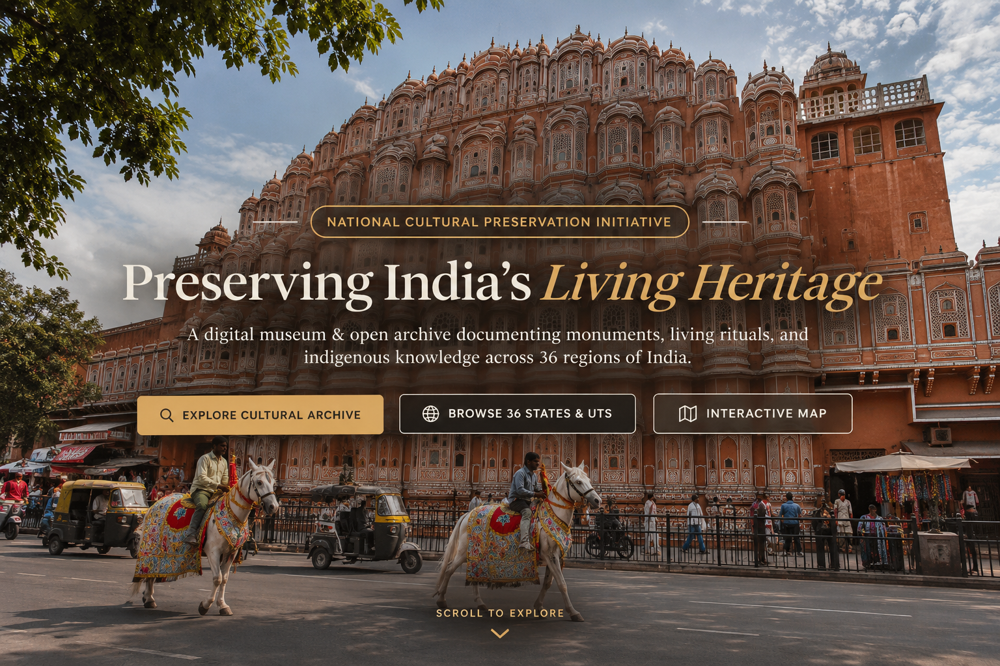

# 🏛️ Indian Cultural Heritage Archive (DCHA)

<p align="center">
  
</p>

<h3 align="center">Preserving India's Heritage • Celebrating Its Living Culture</h3>

<p align="center">
  A Digital Repository of India's Heritage, Culture, Monuments, Art, Festivals & Traditions.
</p>

<p align="center">
  
  
  
  
  
</p>

---

## 📋 Overview

DCHA serves as a digital museum, cultural archive, heritage discovery platform, and educational resource — combining interactive maps, community contributions, and curator management into one unified platform.

### Key Features

- **Complete India Coverage** — All 28 states + 8 union territories with unique cultural data
- **Heritage Directory** — Monuments, temples, forts, palaces, archaeological sites, UNESCO sites
- **Interactive India Map** — SVG-based clickable map with heritage markers and geolocation
- **Virtual Museum** — Exhibition-style browsing of cultural artifacts organized by sections
- **Audio Archive** — Folk music, oral histories, cultural sounds (metadata with HTML5 player)
- **Cultural Calendar** — Month-by-month festival and event navigation
- **Heritage at Risk** — Tracking endangered cultural heritage with risk levels
- **State Comparison** — Side-by-side comparison of any two states' cultural profiles
- **Timeline** — Interactive heritage timeline from Ancient to Modern era
- **Global Search** — Search across all cultural categories with debounced input
- **Contribution Portal** — Multi-step community contribution workflow
- **Collections & Favorites** — Personal cultural collections with save functionality
- **Admin Dashboard** — Content management, submission review, analytics
- **Authentication** — JWT-based auth with bcrypt password hashing
- **Multi-Language UI** — Interface language selector (English, Hindi, Bengali, Tamil, Telugu, Marathi)

## 🛠️ Technology Stack

| Layer | Technology |
|-------|-----------|
| **Frontend** | HTML5, CSS3, Vanilla JavaScript (Fetch API, Component System) |
| **Backend** | Java 17, Spring Boot 3.2.3, Spring Security, Spring Data JPA |
| **Database** | MySQL 8.0 / H2 In-Memory (Dev Profile) |
| **Authentication** | JWT (JJWT 0.12.5), BCrypt Password Hashing |
| **AI Assistant** | Spring Boot AI Service + OpenAI/LLM REST API |
| **Build Tool** | Apache Maven |


## 📁 Project Structure

```
DCHA/
├── frontend/
│   ├── index.html              # Homepage
│   ├── explore.html            # Explore categories
│   ├── states.html             # All states & UTs
│   ├── state-detail.html       # Individual state detail
│   ├── heritage.html           # Heritage directory
│   ├── heritage-detail.html    # Heritage site detail
│   ├── culture.html            # Culture overview
│   ├── traditions.html         # Traditions listing
│   ├── festivals.html          # Festivals listing
│   ├── food.html               # Food directory
│   ├── stories.html            # Folk stories
│   ├── gallery.html            # Cultural gallery
│   ├── timeline.html           # Heritage timeline
│   ├── museum.html             # Virtual museum
│   ├── audio.html              # Audio archive
│   ├── calendar.html           # Cultural calendar
│   ├── at-risk.html            # Heritage at risk
│   ├── compare.html            # Compare states
│   ├── map.html                # Interactive India map
│   ├── search.html             # Global search
│   ├── login.html              # User login
│   ├── register.html           # User registration
│   ├── profile.html            # User profile
│   ├── collections.html        # User collections
│   ├── contribute.html         # Contribution portal
│   ├── about.html              # About page
│   ├── admin/                  # Admin dashboard pages
│   │   ├── dashboard.html
│   │   ├── states.html
│   │   ├── heritage.html
│   │   ├── submissions.html
│   │   ├── users.html
│   │   └── analytics.html
│   ├── css/
│   │   ├── main.css            # Design system
│   │   ├── components.css      # UI components
│   │   ├── responsive.css      # Responsive breakpoints
│   │   └── admin.css           # Admin styles
│   ├── js/
│   │   ├── api.js              # API communication layer
│   │   ├── auth.js             # Authentication logic
│   │   ├── components.js       # Reusable UI components
│   │   ├── data.js             # Fallback data (all 36 states)
│   │   ├── main.js             # Homepage logic
│   │   ├── search.js           # Global search
│   │   ├── map.js              # Interactive SVG map
│   │   ├── favorites.js        # Favorites/collections
│   │   ├── state-detail.js     # State detail logic
│   │   ├── museum.js           # Virtual museum
│   │   ├── calendar.js         # Cultural calendar
│   │   └── admin.js            # Admin dashboard
│   └── assets/
│       ├── images/
│       ├── icons/
│       └── audio/
├── backend/
│   ├── server.js               # Express server entry
│   ├── package.json
│   ├── .env.example
│   ├── config/
│   │   └── database.js         # MySQL connection pool
│   ├── middleware/
│   │   ├── auth.js             # JWT authentication
│   │   ├── validate.js         # Input validation
│   │   └── errorHandler.js     # Error handling
│   └── routes/
│       ├── auth.js             # POST /register, /login, GET /me
│       ├── states.js           # GET /states, /states/:id
│       ├── heritage.js         # GET /heritage, /heritage/:id
│       ├── festivals.js        # GET /festivals
│       ├── foods.js            # GET /foods
│       ├── traditions.js       # GET /traditions
│       ├── dances.js           # GET /dances
│       ├── music.js            # GET /music
│       ├── artsCrafts.js       # GET /artsCrafts
│       ├── stories.js          # GET /stories
│       ├── search.js           # GET /search
│       ├── favorites.js        # GET/POST/DELETE /favorites
│       ├── collections.js      # Collections CRUD
│       ├── contributions.js    # POST /contributions
│       ├── gallery.js          # GET /gallery
│       ├── timeline.js         # GET /timeline
│       ├── museum.js           # GET /museum
│       ├── audio.js            # GET /audio
│       ├── calendar.js         # GET /calendar
│       ├── heritageRisk.js     # GET /heritageRisk
│       ├── newsletter.js       # POST /newsletter
│       ├── admin.js            # Admin endpoints
│       ├── dresses.js          # GET /dresses
│       ├── languages.js        # GET /languages
│       └── compare.js          # GET /compare
├── database/
│   ├── schema.sql              # MySQL table definitions
│   ├── seed.sql                # Seed data (all 36 states/UTs)
│   └── README.md               # Database setup guide
├── README.md
└── .gitignore
```

## 🚀 Getting Started

### Prerequisites

- **Node.js** 18+ ([download](https://nodejs.org/))
- **MySQL** 8.0+ ([download](https://dev.mysql.com/downloads/))
- **Git** (optional)

### 1. Clone/Download the Project

```bash
cd DCHA
```

### 2. MySQL Database Setup

Start your MySQL server, then create the database:

```sql
CREATE DATABASE dcha CHARACTER SET utf8mb4 COLLATE utf8mb4_unicode_ci;
```

Import the schema:

```bash
mysql -u root -p dcha < database/schema.sql
```

Import the seed data:

```bash
mysql -u root -p dcha < database/seed.sql
```

### 3. Backend Setup & Execution (Spring Boot)

Navigate to the `backend-spring` directory:

```bash
cd backend-spring
```

#### Option A: Quick Start with In-Memory H2 Database (No MySQL required)

```bash
mvn clean package -DskipTests
java -jar target/dcha-backend-1.0.0.jar --spring.profiles.active=h2
```

#### Option B: Production Start with MySQL Database

Ensure MySQL is running and database `dcha` is created (`database/schema.sql` and `database/seed.sql` executed).

```bash
mvn clean package -DskipTests
java -jar target/dcha-backend-1.0.0.jar
```

### 4. Access the Application

- **Frontend**: Open `frontend/index.html` in your browser (or serve via standard static file server).
- **Backend API Base**: `http://localhost:8080/api`
- **H2 Console (in H2 profile)**: `http://localhost:8080/h2-console`


## 🔑 Authentication

### Default Admin Account

```
Email: admin@dcha.org
Password: Admin@123
```

### Demo User Accounts

```
Email: user@dcha.org
Password: User@123

Email: curator@dcha.org
Password: Curator@123
```

### JWT Flow

1. Register/Login → receive JWT token
2. Store token in localStorage
3. Send token in `Authorization: Bearer <token>` header
4. Protected routes verify token via middleware

## 📡 API Overview

### Public Endpoints

| Method | Endpoint | Description |
|--------|----------|-------------|
| `GET` | `/api/states` | List all states & UTs |
| `GET` | `/api/states/:id` | State detail with counts |
| `GET` | `/api/heritage` | Heritage sites (filterable) |
| `GET` | `/api/heritage/:id` | Heritage site detail |
| `GET` | `/api/festivals` | Festivals (filterable) |
| `GET` | `/api/foods` | Foods (filterable) |
| `GET` | `/api/traditions` | Traditions |
| `GET` | `/api/dances` | Dances |
| `GET` | `/api/music` | Music |
| `GET` | `/api/artsCrafts` | Arts & Crafts |
| `GET` | `/api/stories` | Folk stories |
| `GET` | `/api/search?q=` | Global search |
| `GET` | `/api/gallery` | Gallery items |
| `GET` | `/api/timeline` | Timeline events |
| `GET` | `/api/museum` | Museum artifacts |
| `GET` | `/api/audio` | Audio archive |
| `GET` | `/api/calendar` | Cultural events |
| `GET` | `/api/heritageRisk` | Heritage at risk |
| `GET` | `/api/compare?state1_id=&state2_id=` | Compare states |

### Auth & Statutory Data Rights Endpoints (DPDP Act, 2023)

| Method | Endpoint | Description |
|--------|----------|-------------|
| `POST` | `/api/auth/register` | Register new user account |
| `POST` | `/api/auth/login` | Authenticate user & issue JWT |
| `POST` | `/api/auth/logout` | Session termination |
| `GET` | `/api/auth/me` | Get authenticated user profile |
| `PUT` | `/api/auth/profile` | Update user profile & archival bio (DPDP Sec 12) |
| `GET` | `/api/auth/export-data` | Export structured personal data JSON (DPDP Sec 11) |
| `DELETE` | `/api/auth/account` | Irreversibly delete account & data (DPDP Sec 12) |

### Protected Endpoints (require JWT)

| Method | Endpoint | Description |
|--------|----------|-------------|
| `GET` | `/api/favorites` | User's favorites |
| `POST` | `/api/favorites` | Add favorite |
| `DELETE` | `/api/favorites/:id` | Remove favorite |
| `POST` | `/api/contributions` | Submit contribution |
| `GET` | `/api/contributions/my` | User's contributions |

### Admin Endpoints (require admin role)

| Method | Endpoint | Description |
|--------|----------|-------------|
| `GET` | `/api/admin/dashboard` | Dashboard metrics |
| `GET` | `/api/admin/contributions` | All contributions |
| `PATCH` | `/api/admin/contributions/:id` | Approve/reject |
| `GET` | `/api/admin/users` | User list |

## 🎨 Design System

The UI follows a premium editorial/museum aesthetic:

- **Colors**: Deep obsidian, warm ivory, antique gold, bronze, forest green, terracotta
- **Typography**: Playfair Display (headings) + Inter (body)
- **Principles**: Museum-style presentation, strong hierarchy, subtle animations, responsive

## 🧪 Troubleshooting

### MySQL Connection Issues

```bash
# Check MySQL is running
mysql -u root -p -e "SELECT 1"

# Verify database exists
mysql -u root -p -e "SHOW DATABASES LIKE 'dcha'"

# Re-import schema
mysql -u root -p dcha < database/schema.sql
```

### Port Already in Use

```bash
# Change PORT in .env
PORT=3001
```

### Module Not Found Errors

```bash
cd backend
rm -rf node_modules
npm install
```

## 🔮 Future Scope

- Augmented Reality (AR) heritage viewing
- Mobile native app (React Native)
- Multilingual content (not just UI labels)
- AI-powered heritage recommendation engine
- 3D artifact scanning and viewing
- Collaborative annotation system
- Heritage tourism route planner
- API for third-party integrations
- Blockchain-based provenance tracking
- Machine learning for heritage risk assessment

## 📄 License

MIT License — see [LICENSE](LICENSE) for details.

## 🙏 Acknowledgments

- Archaeological Survey of India
- UNESCO World Heritage Centre
- Ministry of Culture, Government of India
- State Tourism Boards
- National Museum, New Delhi
- Sahapedia
- Cultural communities across India
---

<p align="center">
  <h2 align="center">🏛️ INDIAN CULTURAL HERITAGE ARCHIVE</h2>
  <h3 align="center">Preserving the Past. Celebrating the Present. Inspiring the Future.</h3>
</p>
